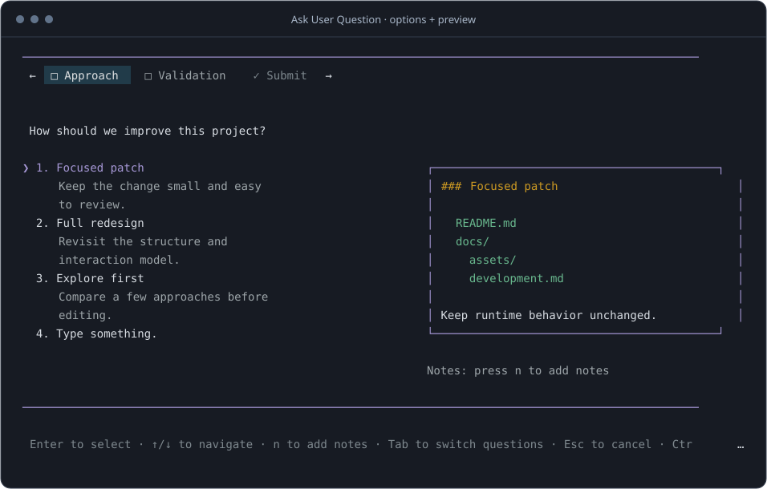
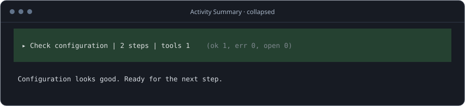
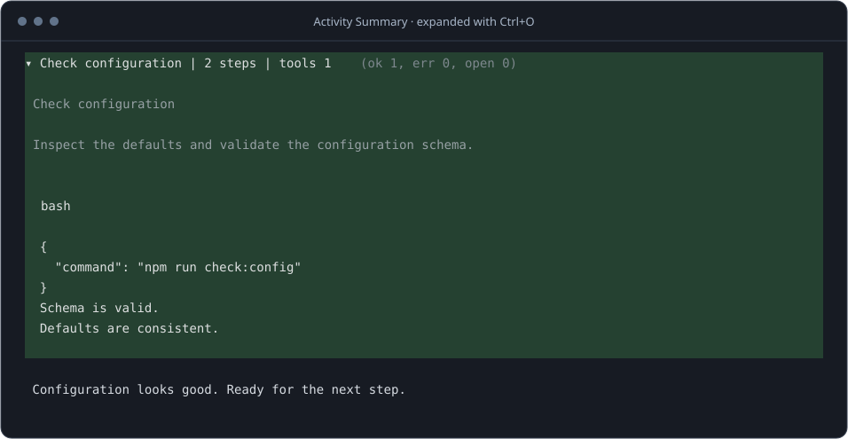

<div align="center">

# Pi Extensions

**需要选择时，问清楚。执行过程中，看重点。**

为 Pi 定制的结构化问答、终端活动摘要、Rex 消息导航、GPT Fast 模式与实时 token 速度。

[插件预览](#插件预览) · [快速开始](#快速开始) · [开发指南](docs/development.md) · [反馈问题](https://github.com/bestdonger/pi-extensions/issues)

</div>

---

## 插件预览

### Ask User Question

把需要你决定的事情，变成可以选择、比较和补充的问卷。



- **一次问清楚** — 最多 10 个问题，支持单选、多选和自由输入。
- **先比较，再决定** — 在选项旁预览代码、配置或界面草图。
- **不打架的对话框** — 问卷排队展示，可取消；等待状态接入 Rex 原生通知。

[问答配置与快捷键 →](packages/ask-user-question/README.md)

### Activity Summary

收起连续的思考和工具输出，让正文留在视线里；支持 regular / fullscreen。用 <kbd>Ctrl</kbd> + <kbd>O</kbd> 全局展开，fullscreen 还可点击摘要单独展开一组。



<details>
<summary><strong>查看展开效果</strong></summary>

<br>



</details>

- **只统计实际活动** — 显示思考与顶层工具的步骤数，仅在工具失败时显示失败数。
- **两种模式同一套摘要** — 保留三行色块和状态色；regular 使用终端历史，fullscreen 使用 Pi 原生滚动、选择复制与单块点击。
- **只改变显示** — 正文实时输出，原始消息、工具结果和模型上下文不变。

[摘要行为与兼容说明 →](packages/activity-summary/README.md)

<sub>以上为 Pi 1.5.0 下真实插件组件的渲染预览，使用离线示例数据；并非桌面截图。终端字体、主题和宽度会影响实际显示。</sub>

### Rex Prompt Navigation

在 Rex 中为真实用户消息恢复 prompt 标记，供 `⌘↑ / ⌘↓` 导航，同时保留 Pi 原生程序状态。用于 Rex + Pi regular TUI，不按 Pi 版本号限制启用。

[实现、兼容边界与验收说明 →](packages/rex-prompt-navigation/README.md)

### GPT Fast Mode

用 `/fast` 快速切换 GPT 的优先处理档位，状态栏显示开关；不改变思考等级。支持 OpenAI API、Codex 协议和兼容网关，按会话分支保存状态，新会话默认关闭。已验证 **Pi 1.5.1**。

Priority 可能消耗更多费用或额度，是否生效由上游决定。

[开关命令、安装与测试 →](packages/fast-mode/README.md)

### Token Speed

状态栏每 250 ms 更新当前响应的平均输出速度，例如 `↑ ~42.6 tok/s`。生成中标注估算，正常结束后用 provider token 用量和宿主耗时校准；不替换原生 footer，可与 Fast Mode 同时显示。速度包含首 token、思考和网络等待。

[统计口径、安装与测试 →](packages/token-speed/README.md)

## 快速开始

> [!IMPORTANT]
> 从 GitHub 安装，尚未发布 npm 包。Activity Summary 与 Rex Prompt Navigation **不按 Pi 版本号限制加载，按实际接口兼容**；本次实测基线为 **Pi 1.5.1**，分别支持 regular/fullscreen 和 regular TUI。

```sh
pi install git:github.com/bestdonger/pi-extensions
```

根包加载五个插件，Pi 自动安装 workspace 运行依赖；Ask 的配置依赖固定为 `@juicesharp/rpiv-config@2.15.0`，不安装第二份 Pi 宿主。

在 Pi 中执行 `/reload`，或重新开启会话。以后只更新本仓库：

```sh
pi update git:github.com/bestdonger/pi-extensions
```

从本地源码迁移时，先用 `pi remove <原本地包路径>` 移除旧的 Ask、Activity 包声明；若 Rex 通过 `~/.pi/agent/extensions/rex-prompt-navigation` 符号链接加载，确认目标后用 `unlink` 移除链接。源码目录保留。

如果已安装原版 Ask 或其他 transcript 折叠插件，先移除或停用对应扩展，避免重复注册工具或同时修改显示。同名工具不要同时加载。

只需部分插件时，用 `pi config` 筛选，或在个人设置中使用包过滤，例如只加载 Ask：

```json
{
  "source": "git:github.com/bestdonger/pi-extensions",
  "extensions": ["packages/ask-user-question/index.ts"]
}
```

开发仍在本仓库进行，见[开发指南](docs/development.md)。

## 文档

| 想做什么 | 从这里开始 |
| --- | --- |
| 调整问答快捷键、预览与配置 | [Ask User Question](packages/ask-user-question/README.md) |
| 了解活动统计、展开和会话恢复 | [Activity Summary](packages/activity-summary/README.md) |
| 使用 Rex 用户消息导航 | [Rex Prompt Navigation](packages/rex-prompt-navigation/README.md) |
| 开关 GPT Fast 优先处理模式 | [GPT Fast Mode](packages/fast-mode/README.md) |
| 实时查看 token 生成速度 | [Token Speed](packages/token-speed/README.md) |
| 修改代码、运行测试、更新预览 | [开发指南](docs/development.md) |
| 报告问题或提出建议 | [GitHub Issues](https://github.com/bestdonger/pi-extensions/issues) |

## 致谢

- **Ask User Question** 基于 [juicesharp/rpiv-mono](https://github.com/juicesharp/rpiv-mono/tree/main/packages/rpiv-ask-user-question) 的同名插件定制，保留原作者信息与 [MIT 许可证](packages/ask-user-question/LICENSE)。
- **Activity Summary** 参考 [luan/agents · pi-collapse-transcript](https://github.com/luan/agents/tree/main/harnesses/pi/agent/packages/pi-collapse-transcript) 的交互思路，为 regular/fullscreen TUI 独立实现，不依赖它或 pi-libtui。
